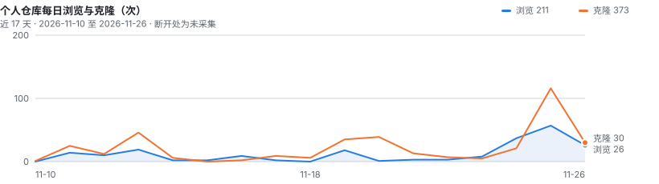

<h1 align="center">Hi, I'm Yoy0o 👋</h1>

  <b>GIS 开发者 · <a href="https://github.com/GeoVerseLabs">GeoVerse Labs</a> 主理人</b> 
  WebGIS · 空间计算 · 数字孪生 · AI Agent

  
  
  

---

## 👨‍💻 关于我

- 🌍 做了多年 WebGIS，从 OpenLayers / Cesium 起步，现在主要做**空间应用的基础工具链**：几何存储、切片服务、地图渲染与编辑、空间计算
- 🧭 特别关注**国内坐标系**的问题（WGS84 / GCJ-02 / BD-09 / CGCS2000），希望坐标在边界上始终是 WGS-84，纠偏都留在引擎内部完成
- 🏭 在做**数字孪生**：仓储三维可视化、仓储仿真、室内路径与场景浏览
- 🤖 在做 **AI Agent 工程化**：让 Agent 安全地调度现有的业务 Web 系统
- 🛠️ 偏好能落地的方案：轻改造、易部署、性能数据能复现

---

## 🌐 GeoVerse Labs

> 面向现代 Web 的空间应用工具链，针对中国坐标系做了专门适配。每一层都能单独使用，组合起来能把空间应用从数据库一路送到浏览器，再交给 AI。
> → [官网](https://geoverselabs.github.io/.github/) · [52 秒介绍片](https://geoverselabs.github.io/.github/film/)

**产品**

| | 简介 |
| --- | --- |
| [GeoVerse SDK](https://geoverse-7yh.pages.dev/) | 基于 OpenLayers / MapLibre GL 的统一地图 API，在引擎内完成国内底图纠偏，自带编辑引擎，并提供 Vue / React 绑定 |
| [GeoVerse Live](https://geoverselabs.github.io/.github/live/) | 基于 SDK 的协同地理数据编辑平台：版本历史、专题制图、实时协同、AI 助手 |

**开源项目**

| 仓库 | 简介 | 技术 |
| --- | --- | --- |
| [geoverse-precise](https://github.com/GeoVerseLabs/geoverse-precise) | 椭球精度的浏览器端空间分析库，可直接替换 turf.js（覆盖全部 184 个导出），支持 CGCS2000 / GCJ-02 / BD-09 · [在线演示](https://geoverselabs.github.io/geoverse-precise/) | Rust · WASM |
| [geoverse-line-finder](https://github.com/GeoVerseLabs/geoverse-line-finder) | 零依赖的 GeoJSON 路网路径规划库，支持 A\* / Dijkstra / ALT 和多楼层室内路径 · [Playground](https://geoverselabs.github.io/geoverse-line-finder/) | TypeScript |
| [geoverse-map-server](https://github.com/GeoVerseLabs/geoverse-map-server) | 单个 Go 二进制，把 PostGIS / MySQL / PMTiles / GeoJSON 等数据发布为 MVT、WMTS、OGC API 和 MCP 服务 | Go |
| [geoverse-cn-coding](https://github.com/GeoVerseLabs/geoverse-cn-coding) | 轻量的中国地址编码服务，提供地址解析、正向 / 逆地理编码和坐标转换，只需一个进程加一个 SQLite 文件 | Python · SQLite |
| [geoverse-sar](https://github.com/GeoVerseLabs/geoverse-sar) | AI 原生的空间应用运行时，UI、工具调用、Agent 与 MCP 共用同一个受管控的内核（技术预览） | TypeScript |
| [mybatis-plus-geometry](https://github.com/GeoVerseLabs/mybatis-plus-geometry) | 打通 MyBatis Plus 与 JTS 几何类型的 Spring Boot Starter（MySQL / PostGIS） | Java |
| [geoverse-skills](https://github.com/GeoVerseLabs/geoverse-skills) | 面向 AI Agent 的空间技能，用来生成货架、库位、展位等确定性区域布局，附带 MCP App | TypeScript · MCP |

---

## 🧪 个人项目

| 仓库 | 简介 |
| --- | --- |
| [Baton](https://github.com/Yoy0o/Baton) | 多系统编排台：一个通用 Agent 通过能力网关调度多个 GIS 类 Web 系统。后端零改动接入，写操作先预览再确认，全程留审计 |
| [geoverse-agent-hub](https://github.com/Yoy0o/geoverse-agent-hub) | 自托管的 Agent 工作台，让各家 coding agent 自动上报任务状态、交付回执和成本；可以单容器部署，也可以部署到 Cloudflare |
| [webProj](https://github.com/Yoy0o/webProj) | 早期作品：在 OpenLayers 中扩展定义常见网络地图投影 |

**参与贡献**

- [pp129/vue-openlayers-map](https://github.com/pp129/vue-openlayers-map)：基于 OpenLayers 的 Vue 地图组件库

**也在探索**

- 🏬 Web 3D 仓库可视化：配置化生成货架 / 地堆，从 CAD 图纸还原库位
- 📦 货到人（RMFS）仓储仿真：支持多层楼面 + 提升机
- 🏔️ 在地图上框选区域，加载 Google 3D Tiles 生成小范围三维场景
- 📡 Web3D 画面推流：WebRTC / WHIP 直推，支持交互回传

---

<!-- STATS:START -->

## 📈 个人仓库数据

| 仓库 | ★ | ⑂ | 近 14 天浏览 | 近 14 天克隆 | 累计浏览 | 下载 | 近 30 天浏览 |
| --- | ---: | ---: | ---: | ---: | ---: | ---: | --- |
| [TerraView](https://github.com/Yoy0o/TerraView) | 0 | 0 | 36 / 1 | 44 / 3 | 36 | 1 |  |
| [hydrosim-web](https://github.com/Yoy0o/hydrosim-web) | 0 | 0 | 32 / 9 | 70 / 38 | 32 | 0 |  |
| [Baton](https://github.com/Yoy0o/Baton) | 0 | 0 | 20 / 1 | 70 / 31 | 20 | 0 |  |
| [geoverse-agent-hub](https://github.com/Yoy0o/geoverse-agent-hub) | 0 | 0 | 3 / 1 | 21 / 18 | 3 | 0 |  |
| [webProj](https://github.com/Yoy0o/webProj) | 0 | 0 | 1 / 1 | 3 / 2 | 1 | 0 |  |

浏览 / 克隆为「次数 / 独立访客」；累计浏览自 2026-11-10 开始采集；下载为 Release 附件与 npm 下载合计。每日由 GitHub Actions 自动更新 · 最近更新 2026-11-25

<!-- STATS:END -->

---

## 🧰 技术栈

---

## 📊 GitHub 统计

  
  

---

## 📫 联系

- 联系人：Yoy0o
- 邮箱：[hio250@163.com](mailto:hio250@163.com)
- 问题与贡献：请到对应仓库提 issue

Mapping infrastructure for the modern web.

